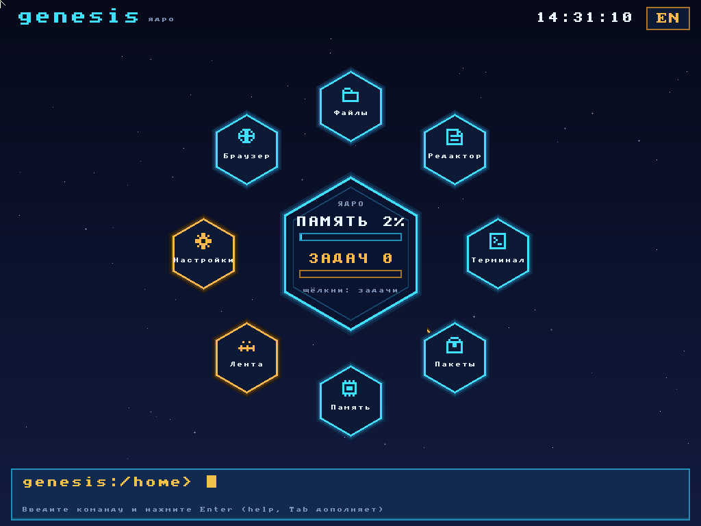
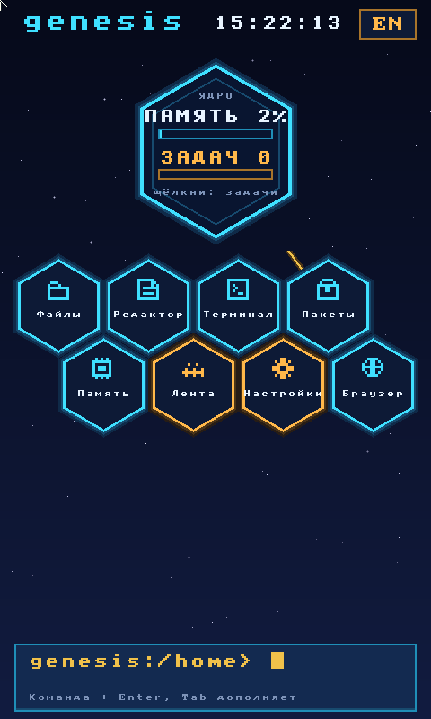

# genesis

Минимальный конвейер загрузки своего ядра для x86_64. Гость стартует в `qemu-system-x86_64` и пишет одну строку и в COM1, и на текстовый экран VGA:

```
genesis: kernel booted
```

Дальше на экране и в serial появляется приглашение `genesis>`. С клавиатуры PS/2 можно набрать строку. В ядре, не в userspace, есть команды `help`, `echo`, `clear`, `mem`, `alloc`, `heap`, `ls`, `cat`, `write`, `run`, `spawn`, `ps` и `desktop`. `mem` читает карту памяти Multiboot2. `alloc` и `heap` работают с bump-аллокатором. При первом запуске в образе диска уже лежат `readme` и плоская программа `hello`. `run hello` печатает `hello from program`. Команда `desktop` открывает домашний экран. Кнопки «Память», «Файлы», «Редактор», «Открыть», «Перезагрузка» и «Выключить» открывают один раздел за раз. У раздела есть «Назад» и нет его на домашнем экране. «Память» показывает строку usable. «Файлы» и «Открыть» показывают имена; щелчок запускает программу просмотра по расширению (`vtxt`, `vdocx`, `vimg`, `vpdf`, `vmp4` на диске). В редакторе буквы дописываются в текст, Enter сохраняет `readme`. Перезагрузка снова показывает домашний экран, выключение завершает QEMU. Те же команды есть в строке `genesis>`.

Многозадачность: таймер PIT (100 Гц) переключает задачи ядра по кругу, у каждой свой стек (до 4 задач, задача 0 — сама оболочка). `spawn ticker` запускает программу с диска фоновой задачей: она пять раз печатает `tick` раз в полсекунды и завершается строкой `task 1 done`, а оболочка и часы тем временем работают. `ps` показывает живые задачи и сколько тиков таймера каждая получила. Программа вызывается как `prog(print, sleep)`, где `sleep(n)` ждёт n тиков. Всё работает в кольце 0, без изоляции памяти. Фоновый запуск — `spawn NAME` или `NAME &`.

Мышь PS/2 тащит область за заголовок и меняет размер за правый нижний угол. Область остаётся на экране. Щелчок по телу области выбирает её и переносит жёлтую рамку. Таймер раз в секунду перерисовывает часы (`time HH:MM:SS`), в том числе пока в другой области выполняется `wait`. Клавиши `1`–`4` тоже выбирают область. Остальные символы набираются в выбранной области; Enter выполняет там `mem`, `ls`, `run hello` или `wait`.

`write` и `edit` сохраняют файл на сырой диск QEMU, без FAT. `edit readme` показывает текущий текст, следующая строка заменяет его и сразу пишется на диск. `cat` по-прежнему печатает файл. Первая загрузка с CD записывает ядро на этот же диск и не трогает уже лежащие файлы. Следующий запуск может идти только с диска, без CD. Команда просмотра держит один и тот же образ `build/genesis-disk.img`. Тесты каждый раз берут свой пустой образ, чтобы не мешать друг другу.

Между двумя гостями есть свой протокол Genesis Link. Это не IP и не TCP. Кадр Ethernet с частным ethertype `0x88B5` только несёт пакет внутри QEMU. Заголовок: байты `G` `L`, версия 1, тип `u8`, длина полезной нагрузки `u16`, контрольная сумма `u16`. Типы: ping, pong и text. Два гостя соединяются сокетной сетью QEMU (`listen` и `connect`). `ping` ждёт `pong`, `say TEXT` показывает текст на другой стороне как `link: TEXT`. Настоящего интернета нет.

Хостовая часть — CLI на Node.js и TypeScript и одна страница React. CLI собирает ISO, запускает QEMU с таймаутом и возвращает код 0 только если в serial есть маркер. Тесты дополнительно сверяют текстовый экран, клавишу, `help`, память, файлы, программу, щелчок мыши, ход часов, набор в области стола, сохранность файла после перезагрузки и снимок стола. Кнопка «Запустить» показывает этот снимок, а не только журнал COM1. Окно QEMU при просмотре не закрывается само.

QEMU через `-kernel` не принимает 64-битный ELF (`Cannot load x86-64 image, give a 32bit one`). Поэтому образ — CD с GRUB: Multiboot2 передаёт управление 32-битной точке входа, ядро само включает long mode. Если старт обрывается раньше, на COM1 будет `ERR M` (нет Multiboot2), `ERR C` (нет CPUID) или `ERR L` (нет long mode).

### Папки и Grid Store (GBF2)

Диск — Grid Store версии 2 (`GBF2`): до 256 файлов и папок, файл до 1 МБ, путь до 63 символов (имя до 31), образ диска 32 МБ (создаётся разреженным). Раскладка: `/bin` — программы, `/lib` — библиотеки `pkg`, `/docs` — примеры, `/home` — ваши файлы и папка по умолчанию. Приглашение показывает текущую папку: `genesis:/home>`.

```
pwd; ls /; ls /docs
mkdir proj; cd proj; write main.c int main;
cd ..; ls proj; cat proj/main.c
cp proj/main.c /docs; mv /docs/main.c old.c
rm proj/main.c; rmdir proj
run hello        # ищет в текущей папке, потом в /bin
```

Пути абсолютные и относительные, с `.` и `..`; их принимают `cat`, `write`, `rm`, `edit`, `sh`, `run`, `grep`, `>`/`>>`. `rmdir` удаляет только пустую папку. Файлы из `import/` попадают в `/home`. В «Файлах» и «Открыть» на рабочем столе папки отмечены `/`: щелчок открывает папку, строка «.. Назад» поднимает на уровень выше (показываются первые 8 строк). Старый плоский диск `GBF1` переводится автоматически при первой загрузке: ваши файлы уезжают в `/home` (библиотеки — в `/lib`), встроенные ставятся заново.

Оболочка в духе bash: Shift и Caps Lock на клавиатуре, стрелки вверх/вниз листают историю (16 строк), Backspace стирает. Кавычки `"..."` и `'...'`, переменные `NAME=value` и `$NAME` (`set` показывает все), `;` между командами, `#` — комментарий, `>` и `>>` пишут вывод в файл Grid Store, `cmd1 | cmd2` передаёт вывод следующей команде (фильтры `grep WORD`, `wc`, `head N`, а также `cat` без аргумента), `NAME &` запускает программу в фоне, `sh FILE` выполняет скрипт построчно. Примеры:

```
X=hello; echo "$X world"
echo one > f1; echo two >> f1; cat f1
ls /bin | grep ticker | wc
echo 'echo hi-$X' > s1; sh s1
ticker &
```

## ???????? ????

`edit ????` ????????? ????????????? ????????; ???? ????? ???, ?? ????? ?????? ??? ??????????.

- ???????, Home/End, PgUp/PgDn ? ???????? ???????; Enter ????????? ??????, Backspace/Delete ???????, Tab ????????? 4 ???????;
- Ctrl+S ? ????????? ? Grid Store (?? 64 ??), Ctrl+Q ??? Esc ? ????? (? ?????????????? ???????? ????? ?????? ??????);
- ????? ?????? ?????????: ??? ?????, `[+]` ??? ??????????, `Ln:Col`; ????? ?????? ?????;
- ????????? ?? ??????????: `.c`/`.h`, `.asm`/`.s`, `.sh` ? ???????? ????? ??????, ??????????? ???????, ?????? ???????, ????? ???????.

???????? ?????????? ?? ??????? ????? ???? ???????, ????????????.

## Windows

Команды из этого файла запускайте в WSL (Ubuntu), не в PowerShell. QEMU, GCC, GRUB и Node ставятся внутрь дистрибутива WSL. Снимки экрана открывают окно QEMU, поэтому нужен дисплей: в WSL это WSLg, и `echo $DISPLAY` не должен быть пустым. Это касается тестов VGA, команды `show` и кнопки «Запустить». Проверка одного только serial окно не открывает.

Без WSLg (WSL 1, переменная $DISPLAY пуста) команда `show` (`npm run look`) сама запускает QEMU для Windows: `C:\Program Files\qemu\qemu-system-x86_64.exe` (поставить: `winget install SoftwareFreedomConservancy.QEMU`). Окно открывается на рабочем столе Windows, QMP идёт через TCP на 127.0.0.1. Другой бинарник QEMU можно задать переменной `GENESIS_QEMU`. Тесты по-прежнему используют QEMU внутри WSL без окна.

## Пакеты хоста

Нужны Node.js 18 или новее (`node` и `npm` в `PATH`), а также NASM, GCC, Binutils, QEMU и GRUB для BIOS.

```bash
sudo apt update
sudo apt install -y build-essential nasm qemu-system-x86 grub-pc-bin grub-common xorriso mtools
```

## Зависимости

Из корня репозитория:

```bash
npm install
npm install --prefix panel
```

## Собрать образ

```bash
npm run build
```

Появляются `build/kernel.elf` и `build/genesis.iso`.

## Запустить в QEMU

```bash
npm start
```

Другой таймаут, в секундах:

```bash
node dist/src/cli.js run --timeout 30
```

Вывод COM1 идёт в терминал. Процесс останавливает QEMU, как только видит маркер, и возвращает код 0. Если за отведённое время (по умолчанию 20 секунд) строки нет, код выхода 1. Снимок serial остаётся в `build/serial.log`. Ускоритель — `tcg`, окно не открывается (`-display none`).

Журнал до приглашения, без кода выхода по одному только маркеру:

```bash
node dist/src/cli.js log --timeout 30
```

## Смотреть стол

Это не тест. Команда открывает настоящее окно QEMU (`-display gtk`), рисует стол и оставляет его, пока окно не закроет человек. Таймаут здесь только про то, сколько ждать появления стола, а не про то, сколько оно висит. Курсор в окне захватывается при наведении: светлая стрелка на экране гостя и есть указатель, щелчок по «Память», «Файлы», «Редактор» или «Открыть» открывает раздел.

```bash
npm run look
```

То же самое без npm-скрипта:

```bash
node dist/src/cli.js show --timeout 40
```

В WSL окно появляется на дисплее WSLg. Закрытие окна завершает команду.

## Тест

```bash
npm test
```

Тест сам поднимает QEMU, проверяет serial и снимки и сам же его останавливает. Он не ждёт, пока кто-то закроет окно, и не заменяет команду просмотра.

Проверяется маркер на COM1, текстовый VGA, клавиша `a`, `help`, `mem`, файлы, `run hello`, `poweroff`, `reboot`, установка на диск и загрузка без CD, русские кнопки домашнего экрана и «Назад», часы, редактор, `edit` и `cat` после новой загрузки того же диска, `say hello-link` между двумя гостями и фоновая задача `spawn ticker`, пока оболочка отвечает на `ps` и `help`.

Эквивалент проверки маркера без test runner, тоже с ограничением по времени и без окна:

```bash
node dist/src/cli.js test --timeout 20
```

Коды выхода CLI: 0 — маркер есть, 1 — нет, 2 — ошибка сборки, нет программ на хосте или неверные аргументы.

## Панель

Одна страница на React. Кнопка «Запустить» собирает образ, открывает окно QEMU на домашнем экране и оставляет его, пока его не закроют. На странице появляется снимок и остаётся: пустое состояние, загрузка и ошибка не возвращаются сами. Журнал COM1 остаётся под картинкой. Панели открываются щелчком уже в окне QEMU.

```bash
npm run panel
```

Страница открывается на порту 43127: [http://127.0.0.1:43127](http://127.0.0.1:43127). В WSL адрес тот же, в браузере Windows можно открыть его из дистрибутива, если порт проброшен.

## Что в дереве

- `kernel/boot.asm` — заголовок Multiboot2, таблицы страниц, переход в long mode
- `kernel/kernel.c` — COM1, текстовый VGA, PS/2 клавиатура и мышь, память, файлы, редактор и `run`
- `kernel/desktop.c` — домашний экран, окна, часы
- `kernel/mbr.asm` — загрузчик, который стартует ядро с диска
- `kernel/disk.c` — чтение и запись сырого диска, установка ядра на диск
- `kernel/link.c` — Genesis Link поверх Ethernet
- `kernel/irq.asm` — вход прерывания таймера
- `programs/hello.asm` — плоская программа `hello from program`
- `kernel/linker.ld`, `kernel/grub.cfg` — связь ELF и меню GRUB
- `src/pipeline.ts` — сборка ISO и прогон QEMU
- `src/guest.ts` — сессия QEMU, QMP и образ диска
- `src/vga-text.ts` — сверка снимка экрана с глифами VGA
- `src/cli.ts` — команды `build`, `run`, `test`, `log`, `show`
- `test/boot.test.ts` — маркер на COM1 и на экране, клавиша на экране
- `test/shell.test.ts` — команда `help` в serial и на экране
- `test/mem.test.ts`, `test/fs.test.ts`, `test/program.test.ts`, `test/desktop.test.ts` — память, файлы, программа и стол
- `test/mouse.test.ts`, `test/clock.test.ts`, `test/panel-type.test.ts`, `test/disk.test.ts` — мышь, часы, набор в области и диск
- `test/window.test.ts`, `test/busy.test.ts`, `test/edit.test.ts`, `test/editor.test.ts`, `test/home.test.ts`, `test/link.test.ts` — окна, часы во время команды, редактор, домашний экран и Genesis Link
- `panel/` — страница React: кнопка «Запустить» показывает снимок домашнего экрана

## Пакеты (`pkg`)

Сети TCP/IP нет, поэтому «репозиторий пакетов» — это папка `packages/` в проекте. Каждый пакет — `packages/<имя>/` с `pkg.json` (имя, версия, зависимости, описание), исходниками `.c` и заголовком `.h` для тех, кто его использует. При сборке (`npm run build`, `npm run look`, тесты) хост собирает каждый пакет в плоский позиционно-независимый бинарник и вшивает репозиторий в образ ядра (`build/pkgrepo.bin`). Ничего из него не занимает место на диске, пока пакет не установлен.

```
pkg list               # все пакеты в репозитории, версии, зависимости, [installed]
pkg install strdemo    # ставит strdemo и его зависимости strlib и mathlib в Grid Store
run strdemo            # пример программы, вызывающей функции strlib и mathlib
pkg installed          # что установлено
pkg remove strdemo     # удаляет; удалить библиотеку, нужную другому пакету, нельзя
```

Связывание во время выполнения: программа получает третий аргумент `sym(lib, name)` и по нему получает адрес функции установленной библиотеки или 0, если библиотеки нет. Тогда программа может вежливо сообщить об ошибке, а не упасть. Библиотека — это файл с меткой `GLIB` и функцией `lib_lookup`. Ядро загружает её при первом обращении и кэширует. Пример есть в `packages/strdemo/strdemo.c`, а общие макросы лежат в `packages/genesis_pkg.h`.

Ограничения: каждый пакет — один файл в Grid Store; программы ставятся в `/bin`, библиотеки в `/lib`. Всего в каталоге 256 мест (файлы и папки), около 19 занимают встроенные. Перед установкой `pkg` проверяет, хватит ли места, и иначе ничего не ставит. Версии только информационные, обновления и выбора версий нет. Код пакетов, как и программ, выполняется в ring 0 без изоляции.

## Русский язык

Весь текст в genesis — UTF-8: файлы, оболочка, вывод на COM1.

- **Раскладка:** `Ctrl+Пробел` или `Alt+Shift` переключает Latin / Русская (ЙЦУКЕН). В текстовой консоли справа вверху видно `RU`/`EN`, в редакторе `edit` — в строке состояния.
- **Шрифт:** `kernel/cyr8x8.h` — А–Я, а–я, Ё/ё, « » — №. Рабочий стол рисует их сам; в текстовом режиме VGA ядро при загрузке кладёт те же глифы в шрифт карты (слоты CP866).
- **Редактор** `edit` двигает курсор и стирает по символам, а не по байтам. `vtxt` и `cat` показывают кириллицу, в том числе из файлов в `import/`.
- Попробовать: `Ctrl+Пробел`, набрать `echo Привет мир`, затем `write ru.txt Ёлка` и `cat ru.txt`.
- **Куда печатать:** после `genesis>` мигает курсор, при загрузке в первой строке есть подсказка. На рабочем столе внизу — строка команд с тем же приглашением и мигающим курсором: набранная команда выполняется по Enter, первая строка ответа видна под ней.

## Стол «Ядро»

`desktop` открывает «Ядро»: в центре светится шестиугольное ядро (память и
фоновые задачи, обновляется раз в секунду, краснеет при куче > 85%), вокруг
соты программ. Щелчок по ядру — список задач с кнопкой «стоп» (`kill N`).
`pkg install` добавляет соту программы, `pin ПАПКА` / `unpin ПАПКА` — соту
папки (`/home/.pins`). Строка внизу выполняет любую команду, подсвечивает
подходящую соту, Tab дополняет команды и пути, стрелки листают историю.

- Телефон: `desktop 480x800` (или `npm run look -- --portrait`) — ядро сверху,
  соты сотами внизу, панели на весь экран с кнопкой «< Назад».
- Телевизор: `desktop 1920x1080` (`npm run look -- --tv`) — крупный текст;
  всё делается пультом: стрелки двигают жёлтую рамку фокуса, Enter открывает,
  Esc/Backspace — назад.



